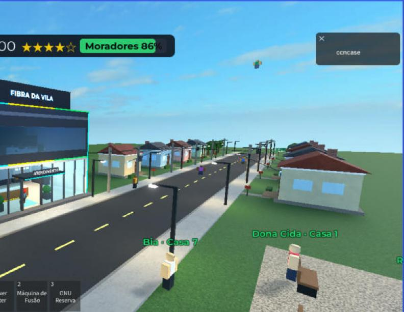

# Provedor de Internet (Fibra da Vila)

Jogo de Roblox em que você monta e administra um provedor de fibra óptica na **Vila Aurora**, uma cidade original. Dá para jogar sozinho ou com amigos.

A vila começa **sem internet**. Os jogadores contratam o link da operadora e compram e configuram de verdade o roteador e a OLT. Depois ligam as casas e mantêm a rede no ar. Os moradores andam pela rua e mostram nos balões como está a internet deles.

> Experiência publicada: **Provedor de Internet** (Roblox). Este repositório guarda o código-fonte e a documentação.



## O que tem no jogo

- **Mundo aberto com até 2 provedores.** Cada jogador chega com R$ 12.000. Ele pode abrir o próprio provedor num dos dois prédios ou entrar como sócio de outro e aportar dinheiro. A rua é compartilhada (rede neutra). Os provedores disputam pelo preço os moradores que estão sem contrato.
- **Rede de verdade, simulada como grafo.** A internet vai do upstream ao roteador, depois à OLT, ao splitter, à CTO, ao drop e à ONU. O sinal é calculado em dBm. Rompimento, conector sujo, ONU queimada, DNS fora do ar e equipamento queimado têm sintomas reais.
- **Datacenter com consoles reais.**
  - Roteador no estilo MikroTik RouterOS, com comandos como `/ip address add`.
  - OLT no estilo Huawei MA5800, com comandos como `ont add ... sn-auth` e `service-port`.
  - Os consoles têm TAB, abreviações e `?` de ajuda.
- **NOC (sala de monitoramento).** O telão mostra a topologia ao vivo. Há também mapa da rua, tráfego, alarmes, chamados, o humor dos moradores e PCs com Ubuntu (ssh, telnet, ping, dig).
- **Rua.** Tem postes, CTOs, splitters, casas com ONU e moradores que conversam. As ferramentas são Power Meter, Máquina de Fusão e Notebook TI.
- **Gestão.**
  - Caixa, estoque de insumos, crédito do governo, SLA e multas.
  - Equipe de técnicos NPC e carro da equipe.
  - Prazo de implantação, manifestação e falência.
- **Wiki dentro do jogo** (tecla J). É o guia prático de como jogar e é atualizada a cada funcionalidade nova.
- **Celular.** As telas se ajustam e têm botões na tela.

## Documentação

| Documento | Conteúdo |
| --- | --- |
| [docs/regras-do-jogo.md](docs/regras-do-jogo.md) | Regras: começo sem internet, provedores, preço, disputa, prazo, manifestação e falência |
| [docs/arquitetura.md](docs/arquitetura.md) | Como o código está organizado: grafo da rede, serviços por provedor, estado e Remotes |
| [docs/instalar-no-studio.md](docs/instalar-no-studio.md) | Como levar o código de `src/` para a experiência no Roblox Studio |
| [docs/testes.md](docs/testes.md) | Comandos de teste (`FibraTeste`) e roteiro de teste manual |
| [CHANGELOG.md](CHANGELOG.md) | Tudo o que entrou no jogo, do mais novo para o mais antigo |

## Estrutura

```
src/
  shared/   -> ReplicatedStorage.Shared       (Config, grafo da rede, falas, wiki, UiFit)
  server/   -> ServerScriptService.Server     (mundo, rede, provedores, rack, equipe, moradores)
    Cli/    -> consoles do roteador, da OLT e do Ubuntu
  client/   -> StarterPlayer.StarterPlayerScripts.Client (HUD, NOC, console, wiki, carro)
tools/
  gen_models.py   gera os .rbxmx para importar no Studio
  build_place.py  gera um place local (.rbxlx) só para teste
default.project.json  mapeamento para o Rojo
```

## Como rodar

O mapa inteiro é montado por código quando o servidor inicia. No modo de edição o Workspace fica quase vazio, então aperte **Play** para ver a cidade.

```bash
python3 tools/gen_models.py v1    # gera modelos/v1_Shared|Server|Client.rbxmx
```

Depois importe os três modelos no Studio. O passo a passo está em [docs/instalar-no-studio.md](docs/instalar-no-studio.md). Também dá para usar o [Rojo](https://rojo.space) com o `default.project.json`.

## Aviso sobre marcas

Os consoles imitam a sintaxe de equipamentos comuns em provedores brasileiros e usam os nomes MikroTik e Huawei só para fins didáticos. O jogo não tem ligação com essas empresas.
